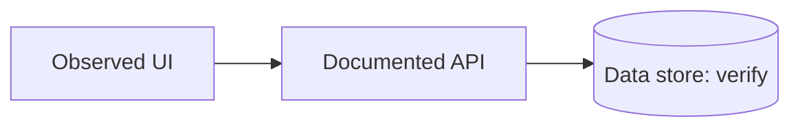

# Reverse Engineering Report: [System]

## 1. Executive summary
- Objective:
- Inputs inspected:
- Scope limitations:
- Key findings:

## 2. Architecture (evidence-grounded)

Clearly label tentative relationships as inferred.

## 3. Inventory
| Component or dependency | Responsibility | Evidence | Confidence |
| --- | --- | --- | --- |
| Example | Purpose | `src/example.ts:12` | Verified |

## 4. User journey / request trace
1. Trigger (evidence)
2. State update (evidence)
3. Endpoint/service call (evidence)
4. Result/error handling (evidence)

## 5. Interface contract
UI: screens, reusable controls, visual tokens, accessibility, breakpoints.
API: method, path, request/response fields, status codes, authentication.

## 6. Evidence and uncertainty
| Claim | Evidence | Confidence | Remaining validation |
| --- | --- | --- | --- |

## 7. Rebuild or migration plan
| Priority | Milestone | Deliverable | Acceptance test |
| --- | --- | --- | --- |
| P0 | Foundation | App shell and domain model | Build and basic test pass |

## 8. Open questions, risks, and licensing
- Missing evidence:
- Security and data privacy constraints:
- Assets or code that require separate permission:
