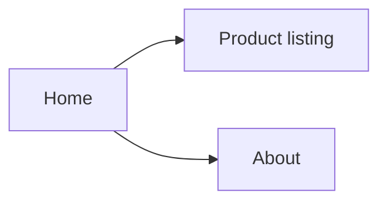
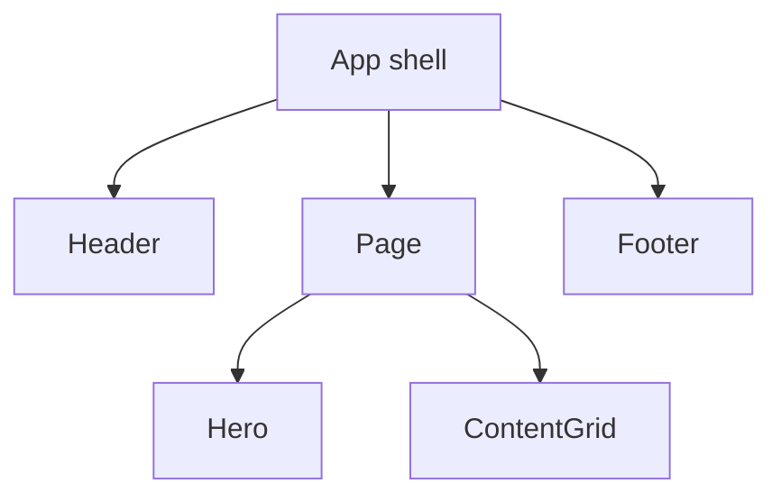

# Website Reverse Engineering v2 Report

## 1. Executive summary
- Target:
- Authorization and scope:
- Captured on:
- Desktop/mobile coverage:
- Key limitations:

## 2. Observed page structure

| Page | Screenshot(s) | Role | Confidence |
| --- | --- | --- | --- |
| / | screenshots/home-desktop.png | Landing | Observed |

> Edges are illustrations only. Replace with observed navigation and cite capture data.

## 3. Responsive UI inventory

| Component | Desktop | Mobile | Evidence | Confidence |
| --- | --- | --- | --- | --- |
| Header | Full-width navigation | Unverified collapse | Screenshot path | Observed / Inferred |

## 4. Candidate design tokens

| Property | Candidate token | Evidence | Confidence |
| --- | --- | --- | --- |
| Primary color | Inspect visually | Computed style sample | Inferred |

## 5. Component hierarchy

## 6. Interactions, forms and accessibility
- Directly observed:
- Inferred behavior:
- Unknown interaction states:
- Keyboard and screen-reader checks:

## 7. Implementation plan

| Stage | Deliverable | Acceptance test |
| --- | --- | --- |
| P0 | Page shell/navigation | Viewport and route smoke tests |
| P1 | Responsive component set | Screenshot comparison |
| P2 | Accessible interactions | Keyboard and error-state tests |

## 8. Evidence and unknowns

| Claim | Capture or screenshot | Confidence | Validation needed |
| --- | --- | --- | --- |

## 9. IP, privacy and limitations

State design ownership, original asset policy, and pages or states that could not be accessed.
